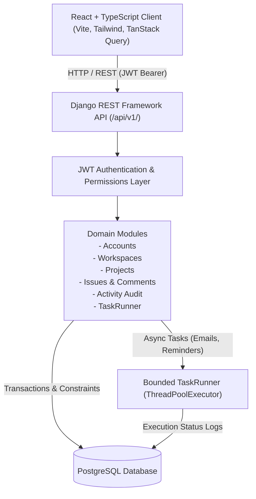
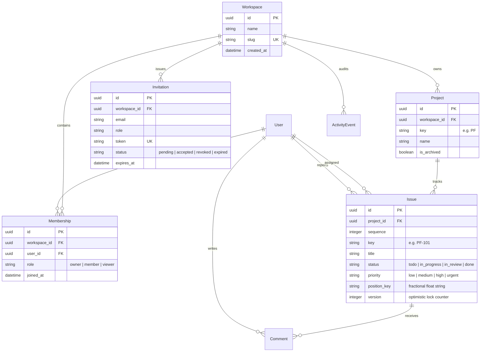
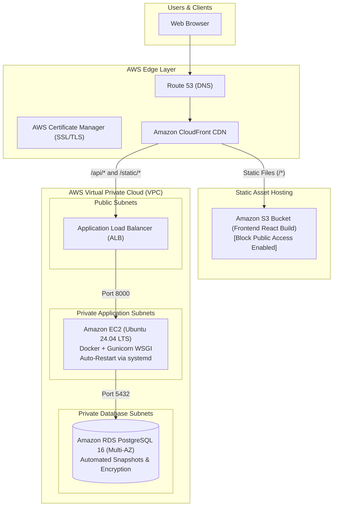

# ProjectFlow

> **Collaborative multi-tenant sprint and issue tracker built with Django REST Framework, React, PostgreSQL, JWT authentication, and optimistic concurrency control.**

Repository: [https://github.com/Shashank-VK/projectflow.git](https://github.com/Shashank-VK/projectflow.git)

---

## 1. Executive Summary

**ProjectFlow** is a work tracking application engineered for agile software teams. Rather than building a superficial clone, ProjectFlow emphasizes architectural depth, strict tenant isolation, fractional Kanban ordering, optimistic concurrency recovery (HTTP 409), and a standardized three-role authorization policy (**Owner**, **Member**, **Viewer**).

Per the system design specification and review addendum:
- **No Aspirational Infrastructure**: Premature Celery and Redis dependencies have been eliminated in favor of a bounded in-process `TaskRunner` backed by database audit logs.
- **Strict Role-Based Access Control**: Viewers have enforced read-only access across all API endpoints (proven by an automated test matrix).
- **Atomic Concurrency & Recovery**: Card moves utilize fractional `position_key` values and optimistic `version` counters. Conflicting simultaneous moves yield an HTTP 409 Conflict with the server's current representation, allowing instant client rollback and retry.
- **Demo Safety**: Reseedable, idempotent demo recovery via `POST /api/demo/reset/` (active only when `DEMO_MODE=True`).

---

## 2. System Architecture

ProjectFlow is designed as a modular monolith. Django and Django REST Framework enforce domain boundaries and authorization invariants. PostgreSQL serves as the relational system of record, and a responsive React single-page application interacts via versioned REST APIs.



### Module Boundaries
- `apps.accounts`: Custom user model (email-based identifier), JWT issue/refresh endpoints, profile and credential management.
- `apps.workspaces`: Multi-tenant boundary, invitations with single-use atomic acceptance, role policies, and workspace metrics.
- `apps.projects`: Projects scoped to workspaces, unique alphanumeric keys (e.g., `PF`), soft archiving with write-lock invariants.
- `apps.issues`: Issues and comments, sequential key generation (`PF-101`), fractional LexoRank-style ordering, optimistic version locking, soft deletion.
- `apps.activity`: Append-only audit log tracking actors, verbs, entity types, and before/after metadata.
- `apps.core`: Custom exception handler (standard JSON error format), `TaskRunner` with `BackgroundTask` database logging, health checks, and demo reset.

---

## 3. Relational Domain Model & Invariants



### Key Invariants
1. **Assignee Boundary**: An assignee must be an active member of the issue's workspace.
2. **Archived Project Mutation Lock**: Archived projects reject issue creations, modifications, and deletions.
3. **Owner Protection**: The final workspace owner cannot be demoted or removed.
4. **Invitation Binding**: Invitations are bound to normalized emails. Accepting while logged in as a mismatched email returns an explanatory recovery notice.
5. **Atomic & Idempotent Acceptance**: Concurrent acceptance requests result in exactly one membership. Subsequent requests return the existing membership.
6. **Optimistic Locking**: Mutations include client `version`. If the database version has advanced, an HTTP 409 Conflict is returned along with the current server record.

---

## 4. Role Matrix

Permissions are enforced at the API layer, not solely by hidden buttons in the user interface:

| Action | Owner | Member | Viewer |
| :--- | :---: | :---: | :---: |
| **Workspace Settings & Name** | ✅ Yes | ❌ No (403) | ❌ No (403) |
| **Invite Members & Revoke/Resend** | ✅ Yes | ❌ No (403) | ❌ No (403) |
| **Manage Member Roles / Remove Members** | ✅ Yes | ❌ No (403) | ❌ No (403) |
| **Create Project** | ✅ Yes | ✅ Yes | ❌ No (403) |
| **Archive / Restore / Delete Project** | ✅ Yes | ❌ No (403) | ❌ No (403) |
| **Create Issue** | ✅ Yes | ✅ Yes | ❌ No (403) |
| **Move Issue / Update Issue Fields** | ✅ Yes | ✅ Yes | ❌ No (403) |
| **Delete Issue** | ✅ Yes | ✅ If Reporter | ❌ No (403) |
| **Create Comment** | ✅ Yes | ✅ Yes | ❌ No (403) |
| **View Board, Issues, Dashboard, Activity** | ✅ Yes | ✅ Yes | ✅ Read-only |

---

## 5. Quick Start & Local Execution

### Prerequisites
- Python 3.12+
- Node.js 20+ & npm
- PostgreSQL 16+ running locally

### 1. Database Setup
```bash
sudo -u postgres psql -c "CREATE USER projectflow WITH PASSWORD 'projectflow' CREATEDB;"
sudo -u postgres psql -c "CREATE DATABASE projectflow OWNER projectflow;"
sudo -u postgres psql -c "GRANT ALL PRIVILEGES ON DATABASE projectflow TO projectflow;"
```

### 2. Backend Setup
```bash
# Create virtual environment and install dependencies
python3 -m venv .venv
source .venv/bin/activate
pip install -r backend/requirements.txt

# Run migrations and seed deterministic demo data
python backend/manage.py migrate
python backend/manage.py seed_demo_data

# Start backend application server
python backend/manage.py runserver 0.0.0.0:8000
```
- API root: `http://localhost:8000/api/v1/`
- Health check: `http://localhost:8000/api/health/`
- Interactive OpenAPI / Swagger UI: `http://localhost:8000/api/docs/`

> **No PostgreSQL? Use SQLite.** Copy `.env.example` to `.env` and set
> `DATABASE_URL=sqlite:///db.sqlite3` (no Postgres server needed). SQLite
> connections run in WAL mode with a 5s busy timeout for serialized writes
> (see `apps/core/apps.py`), and everything — migrations, demo seeding, tests —
> works identically on the SQLite path.

### 3. Frontend Setup
```bash
cd frontend
npm install
npm run build     # Verify TypeScript & Vite bundle
npm run preview   # Or npm run dev
```
- Web Application: `http://localhost:5173/`

---

## 6. Demo Credentials & 5-Minute Walkthrough

### Pre-Seeded Accounts (Password: `password123`)

| Role | Email | Password | Intended Test |
| :--- | :--- | :--- | :--- |
| **Owner** | `owner@projectflow.dev` | `password123` | Full admin, invitations, role changes, project archiving. |
| **Member** | `member@projectflow.dev` | `password123` | Create issues, drag cards, comment, cannot invite/archive. |
| **Viewer** | `viewer@projectflow.dev` | `password123` | Read-only inspection; all mutations rejected with 403. |

### 5-Minute Walkthrough Script
1. **Sign In**: Navigate to `http://localhost:5173/login`. Click the **Owner (Sarah)** quick persona button.
2. **Kanban Board**: Open the board for *Core Platform*. Drag card **PF-102** from *In Progress* to *Done*, or use the card's accessible status buttons.
3. **Issue Drawer & Concurrency**: Click **PF-103** to open the routable drawer. Add a comment. Notice the URL is shareable.
4. **Role Verification**: Use the top navigation bar to switch personas to **Viewer (Taylor)**. Notice mutation buttons are hidden/disabled, and direct API mutations are blocked with 403.
5. **Dashboard & Metrics**: Open the *Dashboard* tab to view real-time counts by status, priority, team member workloads, and overdue issue indicators.
6. **Demo Recovery**: Click the **Reset Demo** button in the header. Confirm the modal to re-seed initial data idempotently.

---

## 7. Verification & Measured Engineering Evidence

### Automated Backend Tests
Run the automated test suite with pytest:
```bash
.venv/bin/pytest backend/tests/ -v
```

**Measured Test Results**:
```text
======================== 33 passed, 1 warning in 45.31s ========================
- test_auth.py: 5/5 PASSED (Registration, JWT token obtain, token refresh, me, change-password)
- test_roles_and_permissions.py: 8/8 PASSED (Full Owner, Member, Viewer matrix across all mutating endpoints)
- test_tenant_isolation.py: 6/6 PASSED (Negative checks across foreign workspaces, projects, issues, dashboard)
- test_invitation_lifecycle.py: 5/5 PASSED (Acceptance, email mismatch rejection, expiry, revocation, concurrency)
- test_issues_concurrency.py: 3/3 PASSED (HTTP 409 conflict detection, current payload return, fractional order, archived lock)
- test_task_runner.py: 2/2 PASSED (In-process execution and BackgroundTask database audit logging)
- test_demo_reset.py: 3/3 PASSED (Auth guard, DEMO_MODE toggle, fixture reseeding)
- test_dashboard.py: 1/1 PASSED (Accurate status/priority/assignee counts, archived exclusions)
```

### OpenAPI 3 Schema Validation
```bash
.venv/bin/python backend/manage.py spectacular --validate --fail-on-warn
# Result: Validation successful. 0 warnings, 0 errors.
```

### Frontend Production Build
```bash
cd frontend && npm run build
# Result: 1,982 modules transformed. Built in 2.63s without errors.
```

---

## 8. Architectural Trade-offs & Deliberate Decisions

1. **Modular Monolith vs. Microservices**:
   - *Chosen*: A single Django backend with decoupled domain apps.
   - *Rationale*: Avoids distributed transactions, network latency, and deployment complexity while preserving clean module boundaries and transactional integrity.
2. **In-Process TaskRunner vs. Celery/Redis**:
   - *Chosen*: A bounded background-thread executor logging task states directly into `BackgroundTask`.
   - *Rationale*: Eliminates external Redis and worker process failure modes in MVP deployments while maintaining asynchronous email delivery and audit tracking.
3. **Fractional Ordering vs. Sequential Renumbering**:
   - *Chosen*: LexoRank-style floating position keys (e.g. `10000.000000`, `15000.000000`).
   - *Rationale*: Card reordering inserts between neighboring keys without locking or updating hundreds of rows in the same column.
4. **Optimistic Locking (409 Conflict)**:
   - *Chosen*: Every mutation checks the record's current `version`.
   - *Rationale*: Prevents silent data overwrite when two teammates move or edit the same card simultaneously.

---

## 9. Run with Docker

ProjectFlow provides a production-grade multi-container Docker configuration wiring the Django REST API, React frontend served by Nginx, and PostgreSQL database.

### Architecture Overview
- **Backend**: Python 3.12-slim multi-stage image running Gunicorn WSGI server. Includes automated database connection wait loop and migration execution.
- **Frontend**: Node 20 alpine build stage compiling static assets, served by Nginx alpine with gzip compression, security headers, SPA client-side routing fallback, and reverse-proxying of `/api/` and `/static/` endpoints.
- **Database**: PostgreSQL 16 alpine with persistent volume storage (`postgres_data`) and integrated healthcheck (`pg_isready`).

### Prerequisites
- [Docker Engine](https://docs.docker.com/engine/install/) 24.0+
- [Docker Compose](https://docs.docker.com/compose/) v2.20+

### Step-by-Step Execution

#### 1. Configure Environment Variables
Copy `.env.example` to `.env`:
```bash
cp .env.example .env
```
The default values in `.env.example` are preconfigured for local Docker Compose runs with PostgreSQL.

#### 2. Build the Docker Images
Build the multi-stage images for backend and frontend:
```bash
docker compose build
```

#### 3. Start the Full Application Stack
Start all services in detached mode:
```bash
docker compose up -d
```
Docker Compose will launch:
1. `projectflow-db` (PostgreSQL 16) and wait for the database health check to pass.
2. `projectflow-backend` (Django + Gunicorn), execute database migrations, and listen on port 8000.
3. `projectflow-frontend` (Nginx + React SPA), listening on port 80.

#### 4. Seed Deterministic Demo Data (Optional)
To populate the database with pre-seeded demo personas (`owner@projectflow.dev`, etc.) and sample workspace:
```bash
docker compose exec backend python manage.py seed_demo_data
```

#### 5. Verify Running Services & Access Endpoints

| Service | Container | Host URL | Description |
| :--- | :--- | :--- | :--- |
| **Frontend Web App** | `projectflow-frontend` | [http://localhost:80](http://localhost:80) | React SPA served via Nginx with API reverse proxy |
| **Backend REST API** | `projectflow-backend` | [http://localhost:8000/api/v1/](http://localhost:8000/api/v1/) | Django REST Framework API root |
| **API Health Check** | `projectflow-backend` | [http://localhost:8000/api/health/](http://localhost:8000/api/health/) | JSON health status check |
| **OpenAPI / Swagger** | `projectflow-backend` | [http://localhost:8000/api/docs/](http://localhost:8000/api/docs/) | Interactive Swagger UI documentation |
| **PostgreSQL Database** | `projectflow-db` | `localhost:5432` | PostgreSQL relational database |

#### 6. Inspect Container Logs
```bash
# View combined live logs
docker compose logs -f

# View backend logs only
docker compose logs -f backend

# View frontend logs only
docker compose logs -f frontend
```

#### 7. Run Automated Tests Inside Containers
Run the complete 33-test suite inside the containerized environment against the PostgreSQL service:
```bash
# Run pytest inside the backend container
docker compose run --rm backend pytest

# Run with verbose output and test summary
docker compose run --rm backend pytest -v

# Run with in-memory SQLite override if testing without Postgres container
docker compose run --rm -e DATABASE_URL=sqlite:///:memory: backend pytest
```

#### 8. Stop the Container Stack
```bash
# Stop and remove containers and network (preserves database volume)
docker compose down

# Stop and wipe database volume completely (clean reset)
docker compose down -v
```

---

## 10. Deploy to AWS

> **Notice**: The instructions below provide a complete, production-grade architectural guide for deploying ProjectFlow to Amazon Web Services (AWS). This guide is documentation-only; no AWS cloud resources are provisioned directly in this repository.

### Architecture Overview



### Deployment Strategy

There are two primary AWS deployment patterns for ProjectFlow:
- **Option 1: Cost-Effective Single EC2 with Docker Compose** (Recommended for MVPs, staging, and demo deployments).
- **Option 2: Production Decoupled S3 + CloudFront + EC2/ECS + RDS** (Recommended for high-scale, multi-tenant production).

---

### Option 1: Step-by-Step Single EC2 Deployment (Docker Compose)

#### Step 1: Provision EC2 Instance
1. In the AWS Management Console, navigate to **EC2** > **Launch Instance**.
2. **Name**: `projectflow-production`.
3. **AMI**: Ubuntu Server 24.04 LTS (x86_64).
4. **Instance Type**: `t3.small` (2 vCPU, 2 GiB RAM) or `t3.medium`.
5. **Key Pair**: Select or generate an RSA key pair (`projectflow-key.pem`).
6. **Network Settings**:
   - Create Security Group `projectflow-ec2-sg`.
   - Inbound Rules:
     - HTTP (Port 80) from `0.0.0.0/0`
     - HTTPS (Port 443) from `0.0.0.0/0`
     - SSH (Port 22) from your IP only
7. **Storage**: 30 GiB gp3 EBS volume.
8. Click **Launch Instance**.

#### Step 2: Install Docker & Docker Compose on EC2
Connect to the EC2 instance via SSH:
```bash
ssh -i projectflow-key.pem ubuntu@<EC2_PUBLIC_IP>
```
Run host provisioning commands:
```bash
sudo apt-get update && sudo apt-get upgrade -y
sudo apt-get install -y ca-certificates curl gnupg lsb-release

# Install Docker Engine and Compose Plugin
sudo install -m 0755 -d /etc/apt/keyrings
curl -fsSL https://download.docker.com/linux/ubuntu/gpg | sudo gpg --dearmor -o /etc/apt/keyrings/docker.gpg
sudo chmod a+r /etc/apt/keyrings/docker.gpg

echo \
  "deb [arch="$(dpkg --print-architecture)" signed-by=/etc/apt/keyrings/docker.gpg] https://download.docker.com/linux/ubuntu \
  "$(. /etc/os-release && echo "$VERSION_CODENAME")" stable" | \
  sudo tee /etc/apt/sources.list.d/docker.list > /dev/null

sudo apt-get update
sudo apt-get install -y docker-ce docker-ce-cli containerd.io docker-buildx-plugin docker-compose-plugin
sudo usermod -aG docker ubuntu
```

#### Step 3: Clone Codebase and Configure Environment
Log out and back in to apply group permissions, then:
```bash
git clone https://github.com/Shashank-VK/projectflow.git
cd projectflow/app

# Generate production environment file
cp .env.example .env
```
Edit `.env` for production:
```bash
nano .env
```
Key production values:
```dotenv
DEBUG=False
SECRET_KEY=<generate-strong-random-64-char-string>
ALLOWED_HOSTS=<EC2_PUBLIC_DNS>,<YOUR_DOMAIN>,localhost
DEMO_MODE=False
POSTGRES_DB=projectflow
POSTGRES_USER=projectflow_admin
POSTGRES_PASSWORD=<strong-database-password>
DATABASE_URL=postgresql://projectflow_admin:<strong-database-password>@db:5432/projectflow
FRONTEND_PORT=80
BACKEND_PORT=8000
```

#### Step 4: Build and Launch Containers
```bash
docker compose build
docker compose up -d

# Verify containers are healthy
docker compose ps

# Seed demo data if testing
docker compose exec backend python manage.py seed_demo_data
```

#### Step 5: TLS / HTTPS Termination with Certbot
Install Certbot on the host to obtain a free Let's Encrypt certificate:
```bash
sudo apt-get install -y certbot
sudo certbot certonly --standalone -d yourdomain.com -d www.yourdomain.com
```
Update `frontend/nginx.conf` with SSL configuration:
```nginx
server {
    listen 80;
    server_name yourdomain.com;
    return 301 https://$host$request_uri;
}

server {
    listen 443 ssl http2;
    server_name yourdomain.com;

    ssl_certificate /etc/letsencrypt/live/yourdomain.com/fullchain.pem;
    ssl_certificate_key /etc/letsencrypt/live/yourdomain.com/privkey.pem;
    # ... proxy configuration matching frontend/nginx.conf
}
```

---

### Option 2: Production Decoupled S3 + CloudFront + RDS

For scalable production deployments, decouple static frontend hosting and database management from application compute:

#### 1. Amazon RDS PostgreSQL
1. Create an **Amazon RDS PostgreSQL 16** instance in private subnets.
2. Select **Multi-AZ deployment** for production high availability.
3. Security Group: Allow inbound port 5432 only from the EC2 backend security group (`projectflow-ec2-sg`).
4. Set `DATABASE_URL=postgresql://<user>:<password>@<rds-endpoint>:5432/<dbname>` in EC2 backend `.env`.

#### 2. Amazon S3 (Frontend Static Hosting)
1. Create an S3 bucket: `projectflow-frontend-assets`.
2. Keep **Block all public access** enabled.
3. Build the frontend locally or in CI/CD:
   ```bash
   cd frontend
   npm ci
   VITE_API_URL=https://api.yourdomain.com npm run build
   ```
4. Sync build artifacts to S3:
   ```bash
   aws s3 sync dist/ s3://projectflow-frontend-assets/ --delete
   ```

#### 3. CloudFront Distribution & Origin Access Control (OAC)
1. Create a **CloudFront Distribution**:
   - **Default Origin**: S3 bucket `projectflow-frontend-assets` using **Origin Access Control (OAC)**.
   - **Secondary Origin**: Application Load Balancer (ALB) pointing to EC2 backend on port 8000.
2. **Behaviors**:
   - Path pattern `/api/*`: Route to ALB origin (Allowed Methods: GET, HEAD, OPTIONS, PUT, POST, PATCH, DELETE; Cache Policy: CachingDisabled; Origin Request Policy: AllViewer).
   - Path pattern `/static/*`: Route to ALB origin (Django admin/swagger assets).
   - Default `/*`: Route to S3 origin with SPA error response:
     - Error Code `403` & `404` -> Custom Response Code `200` with Response Page Path `/index.html`.
3. Attach an **AWS Certificate Manager (ACM)** SSL certificate in `us-east-1` for your custom domain.
4. Point **Route 53** alias record (`A` / `AAAA`) to the CloudFront distribution domain name.

#### 4. AWS Secrets Manager & CI/CD Pipeline
- Store production secrets (`SECRET_KEY`, RDS credentials) in **AWS Secrets Manager**.
- Automate builds with GitHub Actions:
  - On push to `main`, run automated test suite (`pytest`).
  - Build frontend and upload to S3; invalidate CloudFront cache (`aws cloudfront create-invalidation --distribution-id <ID> --paths "/*"`).
  - Build and deploy backend container image to Amazon ECR and trigger rolling update on EC2 / ECS.

---

## 11. License

MIT License. Designed and maintained by Shashank-VK.
