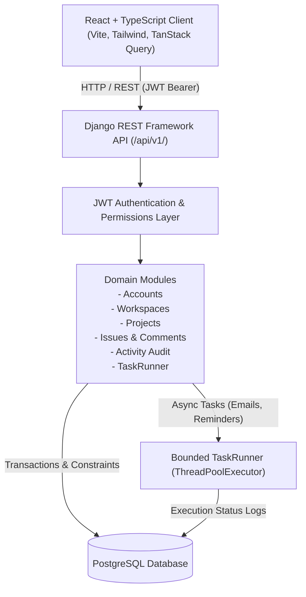
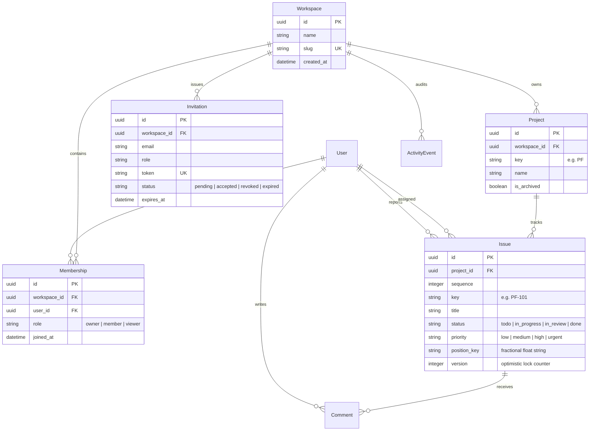

# ProjectFlow

> **Collaborative multi-tenant sprint and issue tracker built with Django REST Framework, React, PostgreSQL, JWT authentication, and optimistic concurrency control.**

Repository: [https://github.com/Shashank-VK/projectflow.git](https://github.com/Shashank-VK/projectflow.git)

---

## 1. Executive Summary

**ProjectFlow** is a work tracking application engineered for agile software teams. Rather than building a superficial clone, ProjectFlow emphasizes architectural depth, strict tenant isolation, fractional Kanban ordering, optimistic concurrency recovery (HTTP 409), and a standardized three-role authorization policy (**Owner**, **Member**, **Viewer**).

Per the system design specification and review addendum:
- **No Aspirational Infrastructure**: Premature Celery and Redis dependencies have been eliminated in favor of a bounded in-process `TaskRunner` backed by database audit logs.
- **Strict Role-Based Access Control**: Viewers have enforced read-only access across all API endpoints (proven by an automated test matrix).
- **Atomic Concurrency & Recovery**: Card moves utilize fractional `position_key` values and optimistic `version` counters. Conflicting simultaneous moves yield an HTTP 409 Conflict with the server's current representation, allowing instant client rollback and retry.
- **Demo Safety**: Reseedable, idempotent demo recovery via `POST /api/demo/reset/` (active only when `DEMO_MODE=True`).

---

## 2. System Architecture

ProjectFlow is designed as a modular monolith. Django and Django REST Framework enforce domain boundaries and authorization invariants. PostgreSQL serves as the relational system of record, and a responsive React single-page application interacts via versioned REST APIs.



### Module Boundaries
- `apps.accounts`: Custom user model (email-based identifier), JWT issue/refresh endpoints, profile and credential management.
- `apps.workspaces`: Multi-tenant boundary, invitations with single-use atomic acceptance, role policies, and workspace metrics.
- `apps.projects`: Projects scoped to workspaces, unique alphanumeric keys (e.g., `PF`), soft archiving with write-lock invariants.
- `apps.issues`: Issues and comments, sequential key generation (`PF-101`), fractional LexoRank-style ordering, optimistic version locking, soft deletion.
- `apps.activity`: Append-only audit log tracking actors, verbs, entity types, and before/after metadata.
- `apps.core`: Custom exception handler (standard JSON error format), `TaskRunner` with `BackgroundTask` database logging, health checks, and demo reset.

---

## 3. Relational Domain Model & Invariants



### Key Invariants
1. **Assignee Boundary**: An assignee must be an active member of the issue's workspace.
2. **Archived Project Mutation Lock**: Archived projects reject issue creations, modifications, and deletions.
3. **Owner Protection**: The final workspace owner cannot be demoted or removed.
4. **Invitation Binding**: Invitations are bound to normalized emails. Accepting while logged in as a mismatched email returns an explanatory recovery notice.
5. **Atomic & Idempotent Acceptance**: Concurrent acceptance requests result in exactly one membership. Subsequent requests return the existing membership.
6. **Optimistic Locking**: Mutations include client `version`. If the database version has advanced, an HTTP 409 Conflict is returned along with the current server record.

---

## 4. Role Matrix

Permissions are enforced at the API layer, not solely by hidden buttons in the user interface:

| Action | Owner | Member | Viewer |
| :--- | :---: | :---: | :---: |
| **Workspace Settings & Name** | ✅ Yes | ❌ No (403) | ❌ No (403) |
| **Invite Members & Revoke/Resend** | ✅ Yes | ❌ No (403) | ❌ No (403) |
| **Manage Member Roles / Remove Members** | ✅ Yes | ❌ No (403) | ❌ No (403) |
| **Create Project** | ✅ Yes | ✅ Yes | ❌ No (403) |
| **Archive / Restore / Delete Project** | ✅ Yes | ❌ No (403) | ❌ No (403) |
| **Create Issue** | ✅ Yes | ✅ Yes | ❌ No (403) |
| **Move Issue / Update Issue Fields** | ✅ Yes | ✅ Yes | ❌ No (403) |
| **Delete Issue** | ✅ Yes | ✅ If Reporter | ❌ No (403) |
| **Create Comment** | ✅ Yes | ✅ Yes | ❌ No (403) |
| **View Board, Issues, Dashboard, Activity** | ✅ Yes | ✅ Yes | ✅ Read-only |

---

## 5. Quick Start & Local Execution

### Prerequisites
- Python 3.12+
- Node.js 20+ & npm
- PostgreSQL 16+ running locally

### 1. Database Setup
```bash
sudo -u postgres psql -c "CREATE USER projectflow WITH PASSWORD 'projectflow' CREATEDB;"
sudo -u postgres psql -c "CREATE DATABASE projectflow OWNER projectflow;"
sudo -u postgres psql -c "GRANT ALL PRIVILEGES ON DATABASE projectflow TO projectflow;"
```

### 2. Backend Setup
```bash
# Create virtual environment and install dependencies
python3 -m venv .venv
source .venv/bin/activate
pip install -r backend/requirements.txt

# Run migrations and seed deterministic demo data
python backend/manage.py migrate
python backend/manage.py seed_demo_data

# Start backend application server
python backend/manage.py runserver 0.0.0.0:8000
```
- API root: `http://localhost:8000/api/v1/`
- Health check: `http://localhost:8000/api/health/`
- Interactive OpenAPI / Swagger UI: `http://localhost:8000/api/docs/`

> **No PostgreSQL? Use SQLite.** Copy `.env.example` to `.env` and set
> `DATABASE_URL=sqlite:///db.sqlite3` (no Postgres server needed). SQLite
> connections run in WAL mode with a 5s busy timeout for serialized writes
> (see `apps/core/apps.py`), and everything — migrations, demo seeding, tests —
> works identically on the SQLite path.

### 3. Frontend Setup
```bash
cd frontend
npm install
npm run build     # Verify TypeScript & Vite bundle
npm run preview   # Or npm run dev
```
- Web Application: `http://localhost:5173/`

---

## 6. Demo Credentials & 5-Minute Walkthrough

### Pre-Seeded Accounts (Password: `password123`)

| Role | Email | Password | Intended Test |
| :--- | :--- | :--- | :--- |
| **Owner** | `owner@projectflow.dev` | `password123` | Full admin, invitations, role changes, project archiving. |
| **Member** | `member@projectflow.dev` | `password123` | Create issues, drag cards, comment, cannot invite/archive. |
| **Viewer** | `viewer@projectflow.dev` | `password123` | Read-only inspection; all mutations rejected with 403. |

### 5-Minute Walkthrough Script
1. **Sign In**: Navigate to `http://localhost:5173/login`. Click the **Owner (Sarah)** quick persona button.
2. **Kanban Board**: Open the board for *Core Platform*. Drag card **PF-102** from *In Progress* to *Done*, or use the card's accessible status buttons.
3. **Issue Drawer & Concurrency**: Click **PF-103** to open the routable drawer. Add a comment. Notice the URL is shareable.
4. **Role Verification**: Use the top navigation bar to switch personas to **Viewer (Taylor)**. Notice mutation buttons are hidden/disabled, and direct API mutations are blocked with 403.
5. **Dashboard & Metrics**: Open the *Dashboard* tab to view real-time counts by status, priority, team member workloads, and overdue issue indicators.
6. **Demo Recovery**: Click the **Reset Demo** button in the header. Confirm the modal to re-seed initial data idempotently.

---

## 7. Verification & Measured Engineering Evidence

### Automated Backend Tests
Run the automated test suite with pytest:
```bash
.venv/bin/pytest backend/tests/ -v
```

**Measured Test Results**:
```text
======================== 33 passed, 1 warning in 45.31s ========================
- test_auth.py: 5/5 PASSED (Registration, JWT token obtain, token refresh, me, change-password)
- test_roles_and_permissions.py: 8/8 PASSED (Full Owner, Member, Viewer matrix across all mutating endpoints)
- test_tenant_isolation.py: 6/6 PASSED (Negative checks across foreign workspaces, projects, issues, dashboard)
- test_invitation_lifecycle.py: 5/5 PASSED (Acceptance, email mismatch rejection, expiry, revocation, concurrency)
- test_issues_concurrency.py: 3/3 PASSED (HTTP 409 conflict detection, current payload return, fractional order, archived lock)
- test_task_runner.py: 2/2 PASSED (In-process execution and BackgroundTask database audit logging)
- test_demo_reset.py: 3/3 PASSED (Auth guard, DEMO_MODE toggle, fixture reseeding)
- test_dashboard.py: 1/1 PASSED (Accurate status/priority/assignee counts, archived exclusions)
```

### OpenAPI 3 Schema Validation
```bash
.venv/bin/python backend/manage.py spectacular --validate --fail-on-warn
# Result: Validation successful. 0 warnings, 0 errors.
```

### Frontend Production Build
```bash
cd frontend && npm run build
# Result: 1,982 modules transformed. Built in 2.63s without errors.
```

---

## 8. Architectural Trade-offs & Deliberate Decisions

1. **Modular Monolith vs. Microservices**:
   - *Chosen*: A single Django backend with decoupled domain apps.
   - *Rationale*: Avoids distributed transactions, network latency, and deployment complexity while preserving clean module boundaries and transactional integrity.
2. **In-Process TaskRunner vs. Celery/Redis**:
   - *Chosen*: A bounded background-thread executor logging task states directly into `BackgroundTask`.
   - *Rationale*: Eliminates external Redis and worker process failure modes in MVP deployments while maintaining asynchronous email delivery and audit tracking.
3. **Fractional Ordering vs. Sequential Renumbering**:
   - *Chosen*: LexoRank-style floating position keys (e.g. `10000.000000`, `15000.000000`).
   - *Rationale*: Card reordering inserts between neighboring keys without locking or updating hundreds of rows in the same column.
4. **Optimistic Locking (409 Conflict)**:
   - *Chosen*: Every mutation checks the record's current `version`.
   - *Rationale*: Prevents silent data overwrite when two teammates move or edit the same card simultaneously.

---

## 9. License

MIT License. Designed and maintained by Shashank-VK.
